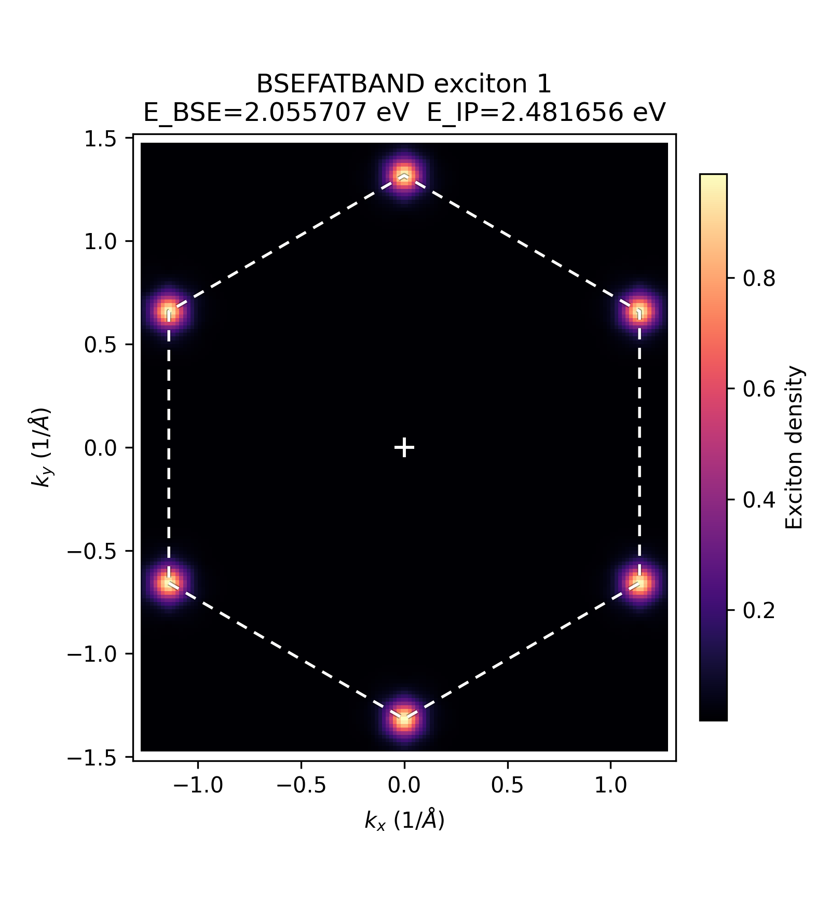
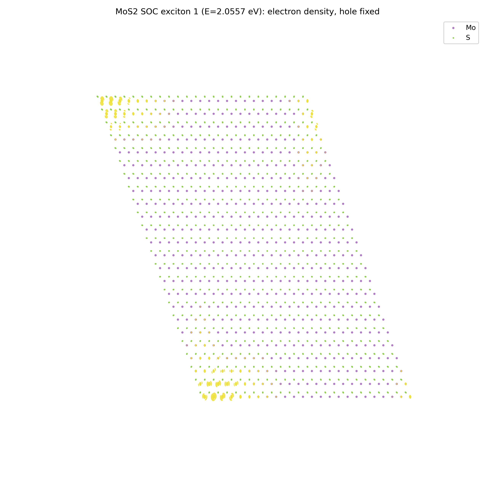

# bseplot NCL (spin-orbit) BZ Example

A minimal example demonstrating `bseplot bz` on a non-collinear (`LSORBIT = .TRUE.`) VASP BSE
calculation, i.e. `BSEFATBAND` written by `vasp_ncl`. This exercises `bseplot`'s NCL support: the
reciprocal-space density plot never reads `WAVECAR`, so it works on a spinor BSEFATBAND unmodified.

Source: a monolayer MoS2 SOC GW-BSE run (`ALGO = BSE`, `LSORBIT = .TRUE.`, `KPOINT_BSE = 1 0 0 0`
i.e. q=0, both the exchange and direct terms included, `ANTIRES = 2`). See the bundled `INCAR` for
the full settings.

Included files:
- `BSEFATBAND`: truncated to the **first 10 excitons** (out of 100 in the original run) to keep
  the file small; the header line was rewritten accordingly (`xdim=13244 nexciton=10`). The
  transition data for those 10 excitons is byte-identical to the original.
- `INCAR`, `KPOINTS`, `OUTCAR`, `POSCAR`: structural/run metadata (small files only -- `WAVECAR`,
  `WAVEDER`, `POTCAR`, and the HDF5/XML outputs were intentionally **not** copied; they are large
  and are not needed for the `bz` workflow below).
- `BSEFATBAND_exciton_NNN_bz.png`: first-BZ exciton density for each of the 10 bundled excitons.

Generate the plots:

```bash
bseplot bz --input BSEFATBAND --poscar POSCAR --all --output-dir . --prefix BSEFATBAND
```

(`--all` processes every exciton in the truncated file; use `--exciton 1` etc. to pick one.)
`bseplot bz --input BSEFATBAND --list` prints just the BSE/IP eigenvalues without plotting.

Example output (exciton 1, the lowest-energy K/K'-valley bright exciton at E=2.0557 eV):



## Real-space reconstruction (`bseplot realspace`)

`bseplot realspace` also works on this spinor BSEFATBAND now, but needs the matching `WAVECAR`
(1 GB+ here), which is not bundled for size reasons. The command used to generate the figure
below (with the real `WAVECAR` of this run):

```bash
bseplot realspace --bsefatband BSEFATBAND --wavecar /path/to/WAVECAR --poscar POSCAR \
    --lsorbit --exciton 1 --hole-from-max-akcv --cumulative-weight 1.0 \
    --output-dir . --prefix ncl_exciton
```

`--cumulative-weight 1.0` uses all 13244 transitions (matches `bse.F` exactly); on this system it
takes about 30 seconds and produces an 800+ MB `.vasp` scalar grid (not bundled here either).
Since VESTA has no scriptable/CLI rendering mode, the figure below was instead rendered directly
from that `.vasp` file with a small Python isosurface script (`skimage.measure.marching_cubes` +
matplotlib), not VESTA itself:



The electron density (hole fixed at its dominant transition's valence-state density maximum)
clusters at two opposite corners of the supercell -- the same periodic-corner-clustering pattern
seen in the collinear reference images in [examples/bseplot](../bseplot), which is the expected
signature of this reconstruction method (Bloch-periodic supercell tiling), not an artifact.

Only direct k-point matches and pure time reversal are supported for spinor wavefunctions; a BSE
k-point that only matches the irreducible WAVECAR mesh via a non-identity symmetry operation uses
VASP's own `spinsym.F` algorithm (axis-angle -> SU(2) spin rotation, plus the extra phase factor
for improper operations) to rotate the spinor, which has **not** been independently validated
against a known-good VASP reference -- see `pauli_spin_rotation_matrix`'s docstring in
`bsefatband.py` for the exact caveat. This particular run uses `ISYM=3` (12 space-group
operations), so most transitions do exercise that rotation.

The transition-dipole-moment option (`--tdm`) needs `WAVECAR` and optionally `WAVEDER`, neither of
which is bundled here either.
